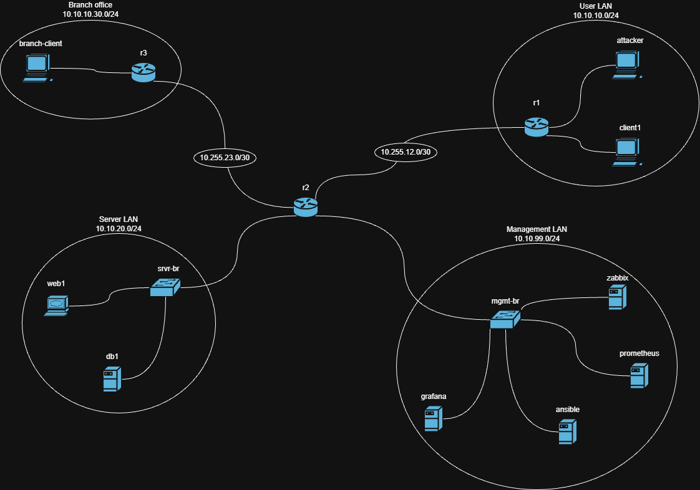

# Verkonhallinta: viikko 1

## 1 Johdanto

Tämän dokumentaation tarkoituksena on dokumentoida Verkonhallinta-kurssin virtuaalisen verkkoympäristön rakenne. Rakenteeseen kuuluu verkon sisältämät laitteet, niiden IP-osoitesuunnitelma, sekä laitteiden välinen reititys.

## 2 Verkkokaavio



## 3 Laiteluettelo

| Laite | Tarkoitus |
|---------|---------|
| r1 | FRR-reititin. Yhdistää käyttäjäverkon runkoverkkoon. |
| r2 | FRR-reititin. Yhdistää palvelin- ja hallintaverkot, sekä r1 ja r3 -reitittimet. |
| r3 | FRR-reititin. Yhdistää etätoimipisteen verkon runkoverkkoon. |
| client1 | Päätelaite. Sijaitsee käyttäjäverkossa. |
| attacker | Kali Linuxia pyörittävä testauslaite tietoturvahyökkäysten simuloimiseen |
| web1 | Web-palvelin. Vastaanottaa käyttäjien pyyntöjä ja näyttää verkkosivuja. |
| db1 | Tietokantapalvelin. Säilyttää, muokkaa ja tallentaa sovellusdataa. |
| branch-client | Päätelaite. Sijaitsee etätoimipisteen verkossa. |
| ansible | Automaatiopalvelin. Käytetään verkkolaitteiden ja palvelinten automaattiseen konfigurointiin. |
| prometheus | Metriikkapalvelin. Kerää ja tallentaa suorituskyky- ja tilastotietoa. |
| grafana | Visualisointipalvelin. Muodostaa ja näyttää dataa erilaisina kuvaajina. |
| zabbix | Valvontapalvelin. Valvoo verkkolaitteiden/-palveluiden toimintakuntoa. |

## 4 IP-suunnitelma

### 4.1 Verkot

| Verkko | Tarkoitus | Laitteet |
|---------|---------|---------|
| 10.10.10.0/24 | User LAN | r1, client1, attacker |
| 10.10.20.0/24 | Server LAN | r2, web1, db1 |
| 10.10.30.0/24 | Branch office | r3, branch-client |
| 10.10.99.0/24 | Management LAN | r2, ansible, prometheus, grafana, zabbix |

### 4.2 Aliverkot

| Verkko | Tarkoitus |
|---------|---------|
| 10.255.12.0/30 | Runkolinkki r1 ja r2 välillä. |
| 10.255.23.0/30 | Runkolinkki r2 ja r3 välillä. |

### 4.3 Yhdyskäytävät

| Reititin | Rajapinta | Yhdyskäytävä verkolle |
|---------|---------|---------|
| r1 | 10.10.10.1 | User LAN |
| r2 | 10.10.20.1<br>10.10.99.1 | Server LAN<br>Management LAN |
| r3 | 10.10.30.1 | Branch office |

### 4.4 Tärkeimmät IP-osoitteet

| Laite | Portti | IP-osoite | Verkko | Kuvaus |
|---------|---------|---------|---------|---------|
| r1 | eth2 |  10.10.10.1/24 | User LAN | Käyttäjäverkon yhdyskäytävä |
| client1 | eth1 | 10.10.10.101/24 | User LAN | Käyttäjän työasema |
| attacker | eth1 | 10.10.10.200/24 | User LAN | Testauslaite (Kali Linux) |
| r2 | eth2 | 10.10.20.1/24 | Server LAN | Palvelinverkon yhdyskäytävä |
| web1 | eth1 | 10.10.20.101/24 | Server LAN | Web-palvelin |
| db1 | eth1 | 10.10.20.102/24 | Server LAN | Tietokantapalvelin |
| r3 | eth2 | 10.10.30.1/24 | Branch office | Etätoimipisteen yhdyskäytävä |
| branch-client | eth1 | 10.10.30.101/24 | Branch office | Etätoimipisteen työasema |
| r2 | eth3 | 10.10.99.1/24 | Management LAN | Hallintaverkon yhdyskäytävä |
| r1 | eth1 | 10.255.12.1/30 | 10.255.12.0/30 | Runkolinkki r1 --> r2 |
| r2 | eth1 | 10.255.12.2/30 | 10.255.12.0/30 | Runkolinkki r2 --> r1 |
| r2 | eth4 | 10.255.23.1/30 | 10.255.23.0/30 | Runkolinkki r2 --> r3 |
| r3 | eth1 | 10.255.23.2/30 | 10.255.23.0/30  | Runkolinkki r3 --> r2 |

## 5 Reitityksen analyysi

Aluksi ajettiin ```ip addr``` ja ```ip route``` -komennot client1-päätelaitteelta lähtötilanteen selvittämiseksi. Alla on kyseisten komentojen tulosteet.

**ip addr**
```console
1: lo: <LOOPBACK,UP,LOWER_UP> mtu 65536 qdisc noqueue state UNKNOWN group default qlen 1000
    link/loopback 00:00:00:00:00:00 brd 00:00:00:00:00:00
    inet 127.0.0.1/8 scope host lo
       valid_lft forever preferred_lft forever
    inet6 ::1/128 scope host
       valid_lft forever preferred_lft forever
10: eth0@if11: <BROADCAST,MULTICAST,UP,LOWER_UP> mtu 1500 qdisc noqueue state UP group default
    link/ether 02:42:ac:14:14:03 brd ff:ff:ff:ff:ff:ff link-netnsid 0
    inet 172.20.20.3/24 brd 172.20.20.255 scope global eth0
       valid_lft forever preferred_lft forever
    inet6 fe80::42:acff:fe14:1403/64 scope link
       valid_lft forever preferred_lft forever
```
**ip route**
```console
default via 172.20.20.1 dev eth0
172.20.20.0/24 dev eth0 proto kernel scope link src 172.20.20.3
```

### 5.1 Ping-testit

Tämän jälkeen suoritettiin ```ping```-komennot client1-päätelaitteelta web1-palvelimeen sekä branch-client-päätelaitteeseen.

**ping -c 4 10.10.20.101 (web1)**

```console
PING 10.10.20.101 (10.10.20.101) 56(84) bytes of data.

--- 10.10.20.101 ping statistics ---
4 packets transmitted, 0 received, 100% packet loss, time 3015ms
```

**ping -c 4 10.10.30.101 (branch-client)**

```console
PING 10.10.30.101 (10.10.30.101) 56(84) bytes of data.

--- 10.10.30.101 ping statistics ---
4 packets transmitted, 0 received, 100% packet loss, time 3005ms
```

Komentojen tulosten perusteella voidaan päätellä, ettei liikenne saavuta kohdeverkkoja. Kumpikin komento johti 100-prosenttiseen pakettihäviöön.

### 5.2 Traceroute

Tämän jälkeen kokeiltiin reitin jäljitystä client1-päätelaitteelta ```10.10.30.101```-kohteeseen ```traceroute```-komennolla.

**traceroute 10.10.30.101**

```console
traceroute to 10.10.30.101 (10.10.30.101), 30 hops max, 60 byte packets
 1  172.20.20.1 (172.20.20.1)  0.572 ms  0.510 ms  0.487 ms
 2  host.mshome.net (172.30.160.1)  0.466 ms  0.434 ms  0.412 ms
 3  192.168.10.1 (192.168.10.1)  1.444 ms  3.075 ms  1.358 ms
 4  91-154-x-x.isp-provider (91.154.x.x)  4.718 ms  4.679 ms  4.663 ms
 5  * * *
 6  * * *
 7  * * *
 8  * * *
 9  * * *
10  * * *
11  * * *
12  * * *
13  * * *
14  * * *
15  * * *
16  * * *
17  * * *
18  * * *
19  * * *
20  * * *
21  * * *
22  * * *
23  * * *
24  * * *
25  * * *
26  * * *
27  * * *
28  * * *
29  * * *
30  * * *
```

Ensimmäisessä hypyssä liikenne ohjautui ```clab-mgmt```-hallintaverkon yhdyskäytävälle r1-reitittimen sijaan. Tämän jälkeen liikenne jatkui isäntäkoneen virtuaalikytkimen, kotiverkon reitittimen ja operaattorin verkon kautta julkiseen Internetiin. Lopuksi reitin jäljitys päättyi aikakatkaisuun.

### 5.3 Reittitauluanalyysi

Ajettujen ```ip addr``` ja ```ip route```-komentojen perusteella voidaan päätellä, että liikennettä ei ole ohjattu oikeaan liitäntään. Kummankin tulosteessa näkyy ```eth0``` aktiivisena liitäntänä. Sen IP-osoite on ```172.20.20.3/24``` ja se on asetettu oletusreitiksi. Tämä on kuitenkin ```clab-mgmt```-hallintaverkko, eikä r1-reitittimen User LAN-verkko.

Puuttuvat määrittelyt reitityksessä näkyvät myös annetuissa ```ping``` ja ```traceroute```-komennoissa. Koska liikenne ei reitity r1-reitittimen kautta muihin järjestelmän verkkoihin, epäonnistuvat pingausyritykset. Tämän vuoksi myös ```traceroute```-tulosteessa näkyy, kuinka liikenne reitittyy hallintaverkon kautta päätyen lopulta julkiseen Internetiin.

Jotta User LAN-verkon reititys toimisi halutulla tavalla tulisi liikenne ohjata kulkemaan r1-reitittimen kautta.

## 6 Yhteenveto

Eniten aikaa tämän ympäristön dokumentoimisessa meni topologian hahmottamiseen sekä tulosteiden tutkimiseen. Lisäksi aikaa vei verkkokaavion luominen, sillä koen tämänkaltaiset kaaviot hankalina (sekä niiden lukeminen että tekeminen).

Kokemus oli kuitenkin hyvin opettavainen ja uskon tämän tehtävän opettaneen minulle hyvän dokumentoinnin perusoppeja. Kun järjestelmästä luodaan kattava dokumentaatio, helpottaa se mm. vianetsintää. Jos mitään ennen 5.2-osiota ei olisi tehty, olisi ollut hyvin työlästä lähteä selvittämään minkä vuoksi liikenne ei reitity oletetulla tavalla.