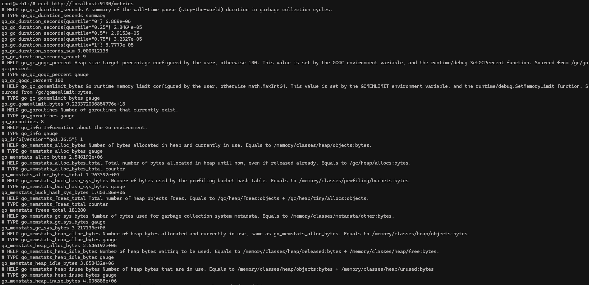
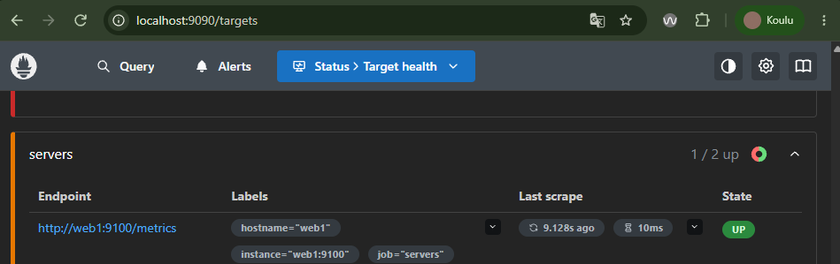
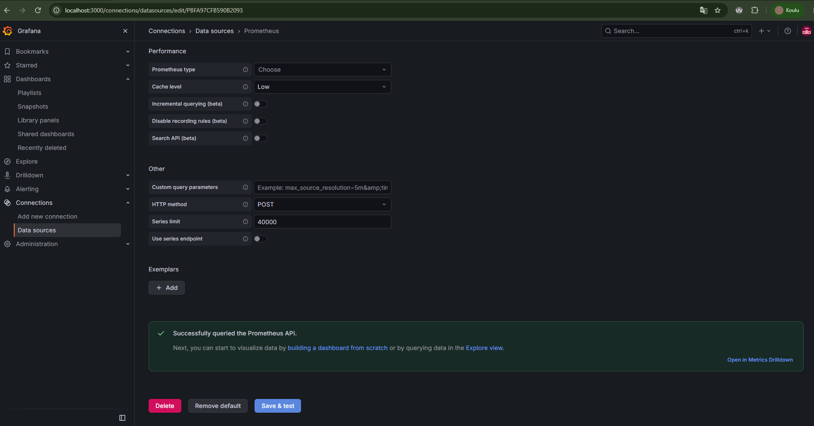
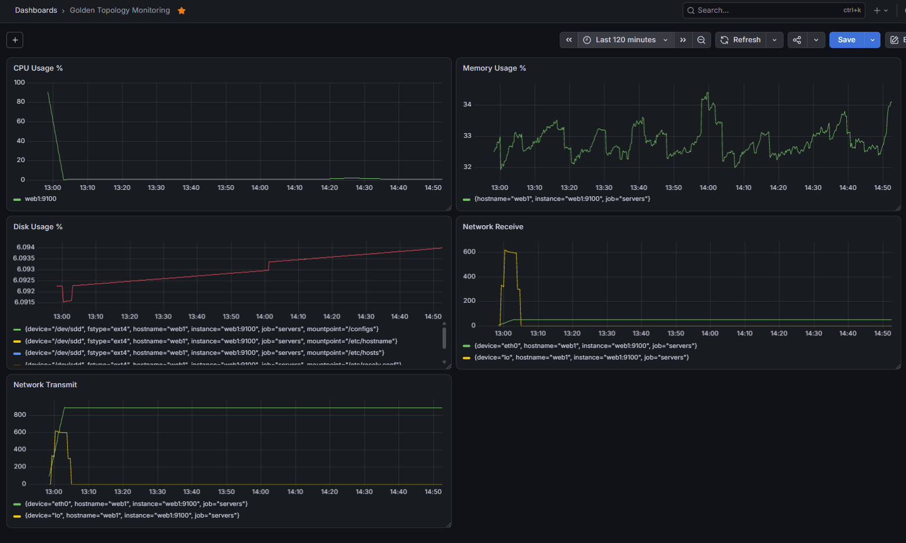
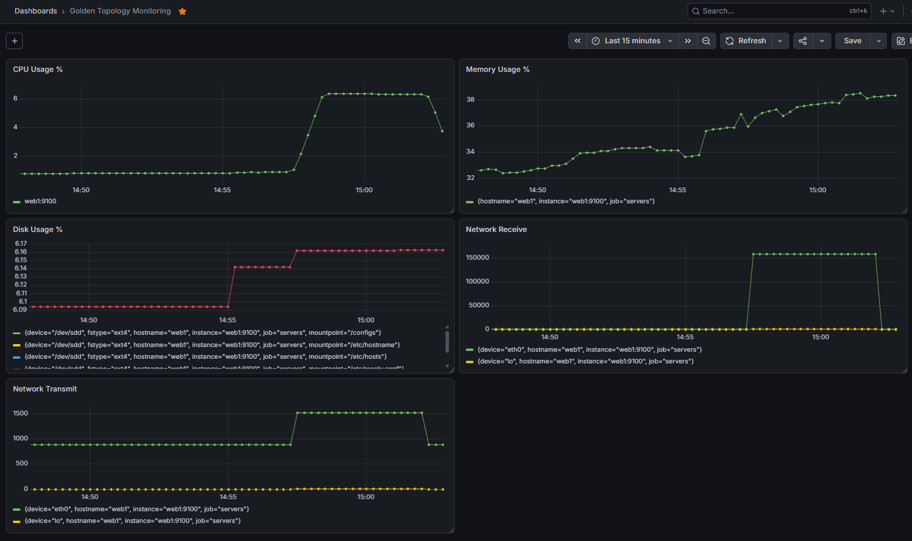

# Verkonhallinta: viikko 3

## 1 Johdanto

Tämän tehtävän tarkoituksena on tutustua laitevalvontaan Prometheuksen avulla. Prometheus on avoimen lähdekoodin monitorointijärjestelmä, joka on suunniteltu yhteensopivaksi skaalautuvien ja dynaamisten ympäristöjen valvontaan (mm. pilvi- ja konttiympäristöihin).

Sen toiminta perustuu malliin, jossa Prometheus-palvelin hakee mittaustietoja tietyin väliajoin HTTP-rajapinnan kautta valvottavilta laitteilta. Tietoa kerätään valvottavalle laitteelle asennetun Node Exporter -agentin avulla.

Prometheus tallentaa kerätyt datat aikasarjatietokantaan. Dataa voidaan visualisoida esim. Grafanan dashboardissa luomalla erilaisia kuvaajapaneeleja käyttämällä PromQL-kyselykieltä.

## 2 Node Exporterin käyttöönotto

1. Kirjauduttiin ```web1```-laitteelle
    ```console
    docker exec -it clab-hamk-verkonhallinta-golden-web1 bash
    ```

2. Asennettiin ```wget``` ja ```tar```-paketit
    ```console
    apt install wget tar -y
    ```

3. Tarkistettiin [Prometheus-GitHubista](https://github.com/prometheus/node_exporter/releases/) uusimman Node Exporterin julkaisunumero (1.12.1) ja asennettiin se
    ```console
    wget https://github.com/prometheus/node_exporter/releases/latest/download/node_exporter-1.12.1.linux-amd64.tar.gz
    ```

4. Purettiin paketti
    ```console
    tar xvf node_exporter-*.linux-amd64.tar.gz
    ```

5. Siirryttiin ```node_exporter```-hakemistoon
    ```console
    cd node_exporter-1.12.1.linux-amd64
    ```

6. Käynnistettiin Node Exporter
    ```console
    ./node_exporter
    ```

---

Lopuksi tarkistettiin, että Node Exporter vastaa avaamalla toinen terminaalivälilehti ja ajamalla ```curl http://localhost:9100/metrics```-komento. Tämän seurauksena konsoliin tulostui toistasataa riviä:





## 3 Prometheus

Ennen Dashboardien rakentamista Grafanaan tarkistettiin vielä Prometheuksesta yhteyksien toiminta. Tämä tehtiin avaamalla selaimeen osoite [http://localhost:9090/targets](http://localhost:9090/targets). Koska Servers-otsikon alta löytyi ```web1:9100/metrics``` statuksella ```UP```, voitiin olettaa yhteyksien toimivan oletetusti.




### 3.1 Grafana

Kirjauduttiin Grafanaan (```http://localhost:3000/```) ja siirryttiin [Data Sources](http://localhost:3000/connections/datasources) -osioon. Klikattiin Prometheusta, varmistettiin että server URL:ksi oli asetettu ```http://prometheus:9090``` ja lopuksi painettiin sivun alalaidassa sijaitsevaa ```Save & test```-painiketta. Yhteys toimi odotetusti, sillä testin seurauksena esille tuli onnistumisilmoitus:



## 4 Dashboard

Tehtävää varten luotiin uusi *Golden Topology Monitoring* -niminen dashboard Grafanaan. Siihen lisättiin viisi paneelia:

1. **CPU Usage %**

    Tämä kysely laskee prosessorin käyttöasteen prosentteina. ```node_cpu_seconds_total``` on laskuri, joka mittaa sekunteina ajan, joka on kulunut suodattimen määrittämään toimintaan. Koska suodatin on ```{mode="idle"}```, lasketaan joutokäyntiaika.

    ```promql
    100 - (avg by(instance)
    (rate(node_cpu_seconds_total{mode="idle"}[5m])) * 100)
    ```

2. **Memory Usage %**

    Tämä kysely palauttaa muistin käyttöasteen prosentteina. ```node_memory_MemTotal_bytes``` kertoo järjestelmän kokonaismuistin määrän tavuina, ```node_memory_MemAvailable_bytes``` taas vapaana olevan muistin määrän tavuina.

    ```promql
    (node_memory_MemTotal_bytes -
    node_memory_MemAvailable_bytes)
    /
    node_memory_MemTotal_bytes
    * 100
    ```

3. **Disk Usage %**

    Tämä kysely laskee liitettyjen tiedostojärjestelmien käytetyn levytilan prosenttiosuuden. ```node_filesystem_avail_bytes``` kertoo vapaana olevan levytilan tavuina ja ```node_filesystem_size_bytes``` tiedostojärjestelmän kokonaiskapasiteetin tavuina.

    ```promql
    100 -
    (
    node_filesystem_avail_bytes
    /
    node_filesystem_size_bytes
    * 100
    )
    ```

4. **Network Receive**

    Tämä kysely kertoo verkkoliitäntöjen keskimääräisen saapuvan liikenteen nopeuden tavuina sekunnissa. ```node_network_receive_bytes_total```-laskuri mittaa vastaanotettujen tavujen kokonaismäärää rajapintakohtaisesti.

    ```promql
    rate(node_network_receive_bytes_total[5m])
    ```

5. **Network Transmit**

    Tämä kysely palauttaa verkkoliitäntöjen keskimääräisen lähtevän liikenteen nopeuden tavuina sekunnissa. ```node_network_transmit_bytes_total```-laskuri mittaa lähetettyjen tavujen kokonaismäärää rajapintakohtaisesti.

    ```promql
    rate(node_network_transmit_bytes_total[5m])
    ```

Alla on kuva valmiista dashboardista:



## 5 Kuormitustesti

Tämän testin aikana ajoin kolme komentoa ```web1```-laitteella:

1.  ```console
    dd if=/dev/zero of=testfile.img bs=1M count=500
    ```
2.  ```console
    apt install -y stress-ng
    ```
3.  ```console
    stress-ng --cpu 4 --timeout 60s
    ```
Jokaisen komennon vaikutus näkyy selkeästi alla olevasta ruutukaappauksesta. Ensimmäinen komento loi 500 Mt kokoisen testitiedoston levylle ja toinen asensi ```stress-ng```-paketin. Molemmat näistä näkyvät *Disk Usage %* -paneelista selkeinä nousuina kuormituksessa. Kolmas komento kuormitti neljää ydintä 60 sekunnin ajan. Myös tämä näkyi selkeänä nousuna suorittimen kuormituksessa - kuvaajasta näemme myös, kuinka tämän minuutin jälkeen kuormituksen määrä lähtee takaisin laskuun.

Dashboardin muista paneeleista voimme huomata myös verkkoliikenteen hetkellisen kasvun. Tämä johtuu ajetusta ```apt install```-komennosta. Käyristä huomataan, että loopback-rajapinnassa ei tapahdu kuormitusta, mutta eth0-rajapinnassa liikenteen määrä nousee hetkellisesti. *Receive*-paneelin liikenteen nousu liittyy suoraan asennusprosessiin, sillä ```stress-ng```-paketti haettiin verkosta. *Transmit*-paneelin tasaisena näkyvä liikenne liittyy Prometheuksen scrape-toimintaan, eli sen tiedonkeruuseen, kun taas käyrän nousu johtuu ```apt install```-komennon lähettämistä pakettipyyntö- ja TCP-kuittauspaketeista.

Lisäksi muistin käyttö nousi kuormitustestien aikana jonkin verran johtuen ajetuista komennoista.



## 6 SNMP vs Prometheus

| Ominaisuus | SNMP | Prometheus |
|------------|------|------------|
| Tiedonkeruu | UDP-pohjainen protokolla, jossa valvontalaite hakee MIB-/OID-arvoja agenteilta, minkä lisäksi agentit voivat lähettää hälytyksiä. | HTTP-pohjainen malli, jossa Prometheus hakee tietoa tietyin väliajoin. Metriikat saadaan tekstimuodossa exporterien rajapinnasta ja ne tallennetaan aikasarjatietokantaan. |
| Käyttöönotto | SNMP on tuettua suurimmalla osalla verkkolaitteista. Käyttöönotto kuitenkin vaatii manuaalista asennus- ja konfiguraatiotyötä (MIB-puu, mahdolliset pääsy- ja tietoturvamäärittelyt jne.). | Melko helppo työkalu ottaa käyttöön asentamalla kohdelaitteeseen Node Exporter ja lisäämällä kyseinen kohde Prometheuksen konfiguraatioon. |
| Mittarien määrä | Rajatumpi kuin mitä Prometheuksessa. Täysin riippuvainen valmiista MIB-rakenteista. | Tämän tehtävän katsauksen perusteella mahdollisuuksia on hyvinkin monipuolisiin mittauksiin. Lisäksi näitä mittareita voi yhdistää, jolloin saatu tieto on moniulotteisempaa. |
| Visualisointi | Kyselytulosteiden lukeminen terminaalista oli raskaan tuntuista, eikä se tarjonnut visualisointimahdollisuuksia. | Exporterin keräämiä tietoja oli todella helppo visualisoida Grafanassa. Kuvaajat tuntuivat selkeiltä ja niiden muokkaaminen oli melko helppoa. |
| Hälytysmahdollisuudet | Valvotut laitteet voivat lähettää SNMP Trap -hälytyksiä, mutta muutoin hälytysmahdollisuudet vaikuttavat melko rajallisilta. | *PromQL*-kyselyihin saanee rakennettua hyvinkin tarkat hälytyssäännöt. Grafanassa itsessäänkin on sisäänrakennettuna *Alerting*-toiminto. |
| Soveltuvuus pilviympäristöihin | Heikko. Käyttö perustuu staattisille IP-osoitteille ja käyttöönotto vaatii manuaalista työtä, joten sen ylläpito skaalautuvissa pilvipalveluissa olisi hyvin työlästä. | Todella hyvä. Prometheus on nimenomaan suunniteltu pilvi- ja konttiympäristöihin sopivaksi. Kunhan tiedonkeruu on aluksi konfiguroitu oikein, vaikuttaa prosessi melko automatisoidulta ja dynaamiselta. |

Nämä kaksi valvontamenetelmää eivät kuitenkaan sulje toisiaan pois, vaan niillä on eri käyttötarkoitukset ja -tilanteet.

## 7 Yhteenveto

Tämä tehtävä opetti minulle modernin monitorointijärjestelmän rakentamista aina exporter-agentin asentamisesta Grafanan dashboardien luomiseen ja tulkitsemiseen. Prometheuksen hyödyt SNMP:hen verrattuna olivat selkeästi monipuoliset tavat käsitellä kerättyä dataa. PromQL-kyselykieli mahdollistaa hyvinkin yksityiskohtaisen datan visualisoinnin Grafanassa. Lisäksi Prometheus soveltuu erinomaisesti mm. pilvi- ja konttiympäristöihin.

Grafanan dashboard tarjoaa dataa seuratuista kohteista niin reaaliaikaisesti kuin historiallisesti. Tärkeitä seurattavia aiheita ylläpitäjälle ovat laitteiden saatavuus, suoritinten käyttöasteet, muistin ja levytilan riittävyys, sekä verkkoliikenteen määrä ja sen virheet. Tehtävässä luotujen paneelien lisäksi kannattaisikin lisätä paneelit esim. ```UP```-statuksen, erilaisten viiveiden ja virheiden, sekä koko järjestelmän kuormituskeskiarvon seuraamiselle.

Erilaisten tietojen monitorointi mahdollistaa niin proaktiivisen järjestelmän hallinnoinnin kuin vianetsinnänkin. Jos järjestelmän ylläpitäjä huomaa levytilan hiljalleen tulevan täyteen, voidaan sitä lisätä ennen kuin se aiheuttaa ongelmia. Vastaavasti ongelmatilanteessa historiallisen tiedon tarkastelu helpottaa juurisyyn selvittämistä. Esimerkiksi jos seurattavan kohteen toiminta hidastuu, voidaan datasta tarkastella, johtuuko ongelma CPU-kuormituksesta, levytilan täyttymisestä, poikkeavasta liikenteen määrästä tai jostakin muusta.