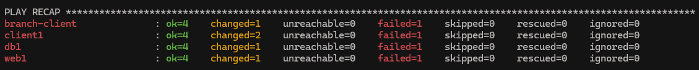
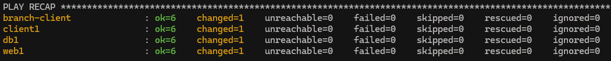
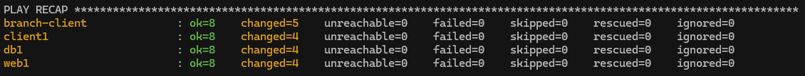
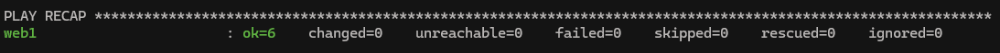

# Verkonhallinta: viikko 4

## 1 Johdanto

*Infrastructure as Code*lla tarkoitetaan erilaisten IT-laitteiden ja -palveluiden muodostaman kokonaisuuden käyttöönottoa ja hallinnointia koodin ja määrittelytiedostojen avulla perinteisemmän manuaalisen tavan sijaan. Perinteisessä mallissa järjestelmän ylläpitäjä kirjautuu SSH-yhteydellä yksittäiselle palvelimelle ja suorittaa siten tarvittavat asennukset sekä määrittää kyseisen laitteen asetukset. *IaC*-ajattelutapa pyrkii virtaviivaistamaan tämän prosessin mahdollistamalla ryhmiin perustuvan hallinnoinnin automaatiotyökalulla.

*IaC*:n suurimmat hyödyt liittyvät manuaalisen työn vähenemiseen, mikä puolestaan parantaa järjestelmien skaalautuvuutta, säästää aikaa sekä vähentää inhimillisistä syistä aiheutuvia virheitä, joita suuri toistomäärä todennäköisesti aiheuttaa. *IaC* pyrkii kuvaamaan järjestelmän tavoitetilaa, minkä vuoksi määrittelytiedostot toimivat samalla järjestelmän dokumentaationa, mikä jälleen vähentää ylimääräisen työn tarvetta. Lisäksi määrittelytiedostoja voidaan versiohallinnoida esimerkiksi Gitin avulla, jolloin myös järjestelmän muutoshistoria on saatavilla.

Tässä tehtävässä tutustutaan *IaC*-ajattelutapaan Ansible-automaatiotyökalun avulla.

## 2 Inventory

Inventoryn rakennetta tutkittiin Ansible-palvelimella komennolla ```cat /ansible/inventory.ini```. Alla on esitetty löydökset roolipohjaisen jaottelun mukaan:

| Ryhmä | Laite | Yhteysasetus | Verkko/IP-osoite |
|---------|---------|---------|---------|
| routers | r1 | network_cli | |
|  | r2 | network_cli | |
|  | r3 | network_cli | |
| servers | web1 | ssh | 10.10.20.101 |
|  | db1 | ssh | 10.10.20.102 |
| clients | client1 | ssh | 10.10.10.101 |
|  | attacker | ssh | 10.10.10.200 |
|  | branch-client | ssh | 10.10.30.101 |
| monitoring | prometheus | ssh | portti 9090 |
|  | grafana | ssh | portti 3000 |
|  | zabbix | ssh | portti 8080 |
|  | cadvisor | ssh | portti 8080 |
| management | ansible | ssh | 172.20.20.0/24 (clab-mgmt) |

Kuten taulukosta huomataan, oli järjestelmän 13 laitetta jaettu viiteen eri ryhmään.

Näiden ryhmien lisäksi laitteet oli jaettu myös muilla perusteilla kolmeen eri kategoriaan, joita olivat:

1. Käyttöjärjestelmäryhmään ```ubuntu_hosts```, joka sisältää laitteet client1, web1, db1 ja branch-client

2. Loogisten aliverkkojen perusteella eri verkko-osioihin:

| Ryhmä | Laite |
|---------|---------|
| käyttäjäverkko (```user_network```) | client1 |
| | attacker |
| palvelinverkko (```server_network```) | web1 |
| | db1 |
| etätyöverkko (```branch_office```) | branch-client |

3. ```:children```-koontiryhmiin:

| Koontiryhmä | Sisältää pääryhmät | Sisältää laitteet |
|---------|---------|---------|
| ```network_devices:children``` | routers | r1, r2, r3 |
| ```linux_hosts:children``` | clients | client1, attacker, branch-client |
| | servers | web1, db1 |
| | monitoring | prometheus, grafana, zabbix, cadvisor|
| | management | ansible |
| ```node_exporter:children``` | routers | r1, r2, r3 |
| | clients | client1, attacker, branch-client |
| | servers | web1, db1 |

Kunkin ryhmän yhteysasetukset on määritelty ryhmämuuttuja ```:vars``` avulla. Esimerkiksi ```servers:vars``` määrittelee yhteystavan (ssh), käyttäjätunnuksen (root), salasanan (Hamk2024!), sekä Python-tulkin polun (/usr/bin/python3):

```console
[servers:vars]
ansible_connection=ssh
ansible_user=root
ansible_ssh_pass=Hamk2024!
ansible_python_interpreter=/usr/bin/python3
```

Ryhmien käyttäminen helpottaa ympäristön hallintaa huomattavasti, sillä se mahdollistaa useamman laitteen toiminnan konfiguroimista kerralla. Tämä parantaa myös skaalautuvuutta. Sen sijaan, että uusille laitteille tarvitsee yksitellen tehdä tarvittavat muutokset, voi laitteet määritellä inventoryssa oikeisiin ryhmiin, jolloin playbookin ajamalla saa kaikki tarvittavat muutokset myös uusilla laitteilla käyttöön. Vastaavasti tämä mahdollistaa myös turhien laitteiden poisrajauksen playbookeja luodessa. Esimerkiksi SSH-playbookeja on turha kohdistaa muihin kuin niitä tarvitseviin ryhmiin/laitteisiin, jolloin vain jätetään kohteista sellaisia laitteita sisältävät ryhmät pois (esim. management).

### 2.1 Järjestelmätietojen kerääminen

Laboratorioympäristön laitteista kerättiin järjestelmätietoja Ansiblen ```setup```-moduulia hyödyntäen komennolla ```ansible all -i ../inventory.ini -m setup```.

| Laite | Käyttöjärjestelmä | IP-osoite | Prosessorien määrä (fyysinen / looginen) | Muistin määrä | Huomioitavaa |
|---------|---------|---------|---------|---------|---------|
| web1 | Ubuntu 24.04 | 172.20.20.3 | 8 / 16 | 7870 MB | |
| db1 | Ubuntu 24.04 | 172.20.20.8 | 8 / 16 | 7870 MB | |
| client1 | Ubuntu 24.04 | 172.20.20.4 | 8 / 16 | 7870 MB | |
| branch-client | Ubuntu 24.04 | 172.20.20.7 | 8 / 16 | 7870 MB | |
| attacker | Kali 2026.3 | 172.20.20.5 | 8 / 16 | 7870 MB | |
| r1, r2, r3 | Ubuntu 24.04 | 172.20.20.6 | 8 / 16 | 7870 MB | ```"ansible_hostname": "ansible"``` |
| prometheus, grafana, zabbix, cadvisor, ansible | - | - | - | - | ```UNREACHABLE [--] "Data could not be sent to remote host \"clab-hamk-verkonhallinta-golden-[laitteen_nimi]\". Make sure this host can be reached over ssh: ssh: connect to host clab-hamk-verkonhallinta-golden-[laitteen_nimi] port 22: Connection refused"``` |

Tästä tulosteesta voitiin päätellä kolme asiaa:

1. ```monitoring``` ja ```management```-ryhmien laitteilla ei ole käynnissä SSH-palvelinta, minkä vuoksi Ansible ei saa niihin yhteyttä.
2. Kaikilla ```servers``` ja ```clients```-ryhmän laitteilla on samat resurssit sillä Docker-kontit jakavat isäntäkoneen ytimen.
3. ```routers```-ryhmän laitteet palauttavat Ansiblen tiedot, sillä ```ansible_hostname``` oli näiden kolmen kohdalla ```ansible```. Tämä johtuu siitä, että ```setup```-moduuli ajetaan hallintapalvelimella eikä hallinnoitavilla laitteilla.

## 3 SNMP-playbook

### 3.1 Tiedostoon tutustuminen

Ensin tutustuttiin Ansiblen ```install-snmp```-playbookiin komennolla ```cat /ansible/playbooks/install-snmp.yml```. Tulostetta tutkimalla saatiin selville seuraavaa:
- Kohderyhmä: ```ubuntu_hosts```, joka sisältää laitteet client1, web1, db1 ja branch-client
- Käytetyt moduulit: ```apt```, ```copy```, ```service```, ```shell```, ```debug```
- Käytetyt muuttujat: ```snmp_community: public```
    - Muuttujaan viitataan *Configure SNMP community* copy-tehtävässä. Tämän muuttujan avulla SNMP-yhteisönimen voi muuttaa yhdestä paikasta.
- ```handlers```-lohko käynnistää snmpd-palvelun uudelleen
    - Lohko ajetaan vain, kun copy-tehtävä on tehnyt snmpd-konfiguraatiotiedostoon muutoksia. Tämä varmistaa, että uudet asetukset astuvat voimaan muutosten jälkeen, mutta myöskin ettei palvelua turhaan käynnistetä uudestaan, jos muutoksia ei ole.

### 3.2 Playbookin ajaminen

Tämän jälkeen ajettiin ```install-snmp```-playbook komennolla ```ansible-playbook -i ../inventory.ini install-snmp.yml```.

Tulos oli tiivistetysti seuraavanlainen:

```console
TASK [Gathering Facts] OK (laitteet: db1, client1, web1, branch-client)
************************************************************************

TASK [Update package cache] OK (laitteet db1, client1, web1, branch-client)
****************************************************************************

TASK [Install SNMP packages] OK (laitteet web1, branch-client, db1) CHANGED (laite client1)
********************************************************************************************

TASK [Configure SNMP community] CHANGED (laitteet web1, branch-client, db1, client1)
*************************************************************************************

TASK [Enable SNMP service] FATAL (laitteet client1, db1, branch-client, web1)
******************************************************************************
fatal: [laitteen_nimi]: FAILED! => {"changed": false, "msg": "Service is in unknown state", "status": {}}
```



### 3.3 Playbookin korjaus ja uudelleenajo

Kuten edellisen luvun tulosteesta huomataan, ei ```install-snmp```-playbookin ajaminen mennyt läpi onnistuneesti. Näin ollen ongelmaa lähdettiin selvittämään avaamalla ja muokkaamalla sitä:

```console
nano install-snmp.yml
```

#### 3.3.1 Enable SNMP service

Korvattiin alkuperäinen *Enable SNMP service* -työ:

```console
- name: Enable SNMP service
      service:
        name: snmpd
        enabled: yes
        state: started
```

Uudella *Ensure SNMP daemon is running* -työllä:

```console
- name: Ensure SNMP daemon is running
      shell: |
        if ! pgrep -x snmpd >/dev/null; then
          /usr/sbin/snmpd
          echo "STARTED"
        fi
      register: snmpd_start
      changed_when: "'STARTED' in snmpd_start.stdout"
```
Koska tämän playbookin kohdelaitteet ovat kevyitä Docker-kontteja, ei niissä ole ```systemd```-palvelunhallintaa. Tämän vuoksi ```service```-moduulia ei voi käyttää palvelun tilan hallintaan. Niinpä korvattiin ```service```-moduuli ```shell```-moduulilla.

Uusi työ tarkistaa ensin onko SNMPD-prosessi käynnissä. Jos se ei ole käynnissä, käynnistetään se komennolla ```/usr/sbin/snmpd```. Lopuksi varmistetaan vielä, ettei tehtävää merkitä changed-tilalla kuin vain, kun tämä työ on oikeasti ajettu.

#### 3.3.2 Verify SNMP process

Lisättiin *Verify SNMP process* -työn ```shell: pgrep snmpd```-riviin ```-x```-lippu, jolloin lopputulos oli:

```console
- name: Verify SNMP process
    shell: pgrep -x snmpd
    register: snmpd_process
    changed_when: false
```
```-x```-lipulla varmistetaan, että ```pgrep```-haku täsmää 100-prosenttisesti ainoastaan ```snmpd```-prosessiin. Näin vältytään virheellisiltä positiivisilta tuloksilta. Tämä siltä varalta, jos jossakin toisessa prosessissa esiintyisi sama merkkijono.

#### 3.3.3 restart snmpd -handler

Muokattiin *restart snmpd* -handleri käyttämään servicen sijaan ```shell```-moduulia ja korvattiin moduulin sisältö, jolloin lopputulokseksi tuli:

```console
- name: restart snmpd
      shell: |
        pkill -x snmpd || true
        sleep 1
        /usr/sbin/snmpd
```
```systemd```:n puuttumisen vuoksi ```snmpd```-palvelua ei voida käynnistää uudestaan ```service```-moduulilla. Tämän vuoksi se on korvattu ```shell```-moduulilla.

```pkill -x snmpd``` pysäyttää mahdollisesti käynnissä olevan ```snmpd```-prosessin. ```|| true``` estää komentoa kaatumasta, jos sellaista prosessia ei vielä ollut käynnissä. Sleepin avulla varmistetaan, että UDP-portti varmasti ehtii vapautua, minkä jälkeen prosessi uudelleenkäynnistetään komennolla ```/usr/sbin/snmpd```.

---

Lopuksi vielä tarkistettiin, että playbookin syntaksi on oikein komennolla

```console
ansible-playbook -i ../inventory.ini install-snmp.yml --syntax-check
```

Koska komennon tuloste oli vain ```playbook: install-snmp.yml```, tiedettiin, että syntaksi on oikein. Näin ollen ```ansible-playbook -i ../inventory.ini install-snmp.yml``` ajettiin uudestaan, minkä jälkeen FATAL-virheitä ei enää tullut ja yhteenveto näytti oletetunlaiselta:



## 4 Node Exporter -playbook

### 4.1 Tiedostoon tutustuminen

Ensin tutustuttiin Ansiblen ```install-node-exporter```-playbookiin komennolla ```cat /ansible/playbooks/install-node-exporter.yml```. Tulostetta tutkimalla saatiin selville seuraavaa:
- Kohderyhmä: ```ubuntu_hosts```, joka sisältää laitteet client1, web1, db1 ja branch-client
- Käytetyt moduulit: ```apt```, ```file```, ```get_url```, ```unarchive```, ```copy```, ```shell```, ```uri```, ```debug```
- Käytetyt muuttujat: ```node_exporter_version: "1.9.1"```
    - Muuttujaan viitataan *Download Node Exporter* get_url-tehtävässä sekä *Install exporter binary* copy-tehtävässä. Muuttujan avulla määritellään mikä versio Node Exporterista ladataan get_url-tehtävässä ja asetetaan oikea tiedostopolku puretulle paketille copy-tehtävässä. Muuttujan avulla Node Exporter voidaan päivittää vaihtamalla versionumero yhteen paikkaan ja ajamalla playbook uudestaan.
- Tässä playbookissa ei käytetä handleria. Tämä johtuu siitä, että Node Exporter ei vaadi konfiguraatiotiedoston käyttöä, toisin kuin SNMP. Lisäksi *Start node_exporter* shell-tehtävä tappaa mahdollisesti käynnissä olevan prosessin ja käynnistää tämän jälkeen prosessin uudestaan, jolloin erillistä handleria ei tarvita.

```console
...
pkill node_exporter || true
nohup /opt/node_exporter/node_exporter
...
```

### 4.2 Playbookin ajaminen

Tämän jälkeen ajettiin ```install-node-exporter```-playbook komennolla ```ansible-playbook -i ../inventory.ini install-node-exporter.yml```.

Tulos oli tiivistetysti seuraavanlainen:

```console
TASK [Install prerequisite packages] OK (laitteet: web1, client1, db1, branch-client)
**************************************************************************************

TASK [Create installation directory] OK (laitteet client1, web1, db1) CHANGED (laite branch-client)
****************************************************************************************************

TASK [Download Node Exporter] CHANGED (laitteet web1, branch-client, client1, db1)
***********************************************************************************

TASK [Extract archive] CHANGED (laitteet branch-client, web1, db1, client1)
****************************************************************************

TASK [Install exporter binary] CHANGED (laitteet branch-client, web1, db1, client1)
************************************************************************************

TASK [Start node_exporter] CHANGED (laitteet db1, client1, web1, branch-client)
********************************************************************************

TASK [Verify exporter responds] OK (laitteet web1, db1, client1, branch-client)
********************************************************************************

TASK [Show verification result] OK (laitteet client1, web1, db1, branch-client)
********************************************************************************
ok: [laitteen_nimi] => {
    "msg": "Node Exporter running on [laitteen_nimi]"
}
```



Toisin sanoen tämän playbookin ajon kanssa ei tullut ongelmia.

## 5 Oman playbookin luominen

Tehtävää varten luotiin playbook, jonka avulla asennetaan Ansiblesta ```web1```-laitteelle apache2-web-palvelin.

Playbook asetettiin täyttämään seuraavat vaatimukset:

- se päivittää pakettilistan

```console
- name: Update package cache
  apt:
    update_cache: yes
```

- asentaa ```apache2```:n

```console
- name: Install Apache2 web server
  apt:
    name: "{{ web_package }}"
    state: present
```

- luo index.html-sivun, joka kertoo palvelimen nimen

```console
- name: Create index.html
  copy:
    dest: "{{ web_root }}/index.html"
    content: |
      <h1>Tervetuloa {{ inventory_hostname }}-palvelimelle!</h1>
  notify: restart apache2
```

- käynnistää ja ottaa palvelun käyttöön
    - Tässä käytettiin suoraan ```shell```-moduulia, sillä tiedettiin jo ```install-snmp```-ajon vuoksi, ettei ```service```-moduuli tulisi toimimaan

```console
- name: Ensure Apache2 service is running
  shell: |
    if ! pgrep -x apache2 >/dev/null; then
      apachectl start
      echo "STARTED"
    fi
  register: apache_start
  changed_when: "'STARTED' in apache_start.stdout"
```

- varmistaa asennuksen onnistumisen

```console
- name: Verify web server responds
  uri:
    url: http://localhost
    status_code: 200
    return_content: yes
  register: web_result

- name: Display verification
  debug:
    msg: "Web server running on {{ inventory_hostname }}: {{ web_result.content | trim }}"
```

Playbookia pääsee tarkastelemaan kokonaisuudessaan [tästä linkistä](playbooks/install-webserver.yml).

### 5.1 Playbookin tuloste

```console
root@ansible:/ansible/playbooks# ansible-playbook -i ../inventory.ini install-webserver.yml

PLAY [Install and configure Apache2 web server]
************************************************

TASK [Update package cache]
*****************************
ok: [web1]

TASK [Install Apache2 web server]
**********************************
changed: [web1]

TASK [Create index.html]
*************************
changed: [web1]

TASK [Ensure Apache2 service is running]
*****************************************
changed: [web1]

TASK [Verify web server responds]
**********************************
ok: [web1]

TASK [Display verification]
****************************
ok: [web1] => {
    "msg": "Web server running on web1: <h1>Tervetuloa web1-palvelimelle!</h1>"
}

RUNNING HANDLER [restart apache2]
**********************************
changed: [web1]

PLAY RECAP
***********
web1   :   ok=7   changed=4   unreachable=0   failed=0   skipped=0   rescued=0   ignored=0
```

Playbookin idempotenssia testattiin vielä ajamalla sama komento uudestaan. Koska mitään muutoksia ei tarvinnut tehdä, palautettiin kaikki työt statuksella OK. Jos muutoksia olisi ollut, olisi se näkynyt CHANGED-sarakkeessa.



## 6 Vertailu

Kunhan on tutustunut playbookien toimintaan ja yml-kieli on tullut tutuksi, on playbookien kaltainen automaatio järjestelmänhallinnassa aivan erinomainen. Tehtävää tehdessä huomasi hyvin konkreettisesti sen kuinka paljon vähemmän aikaa konfiguraatioiden tekeminen vei, kun voi vain ajaa Ansiblelta yhden tai muutaman komennon, sen sijaan, että kirjautuisi erikseen jokaiselle kohdelaitteelle tekemään manuaalisesti useamman eri asennuksen, päivityksen, konfiguraatiomuutoksen, prosessien uudelleenkäynnistyksen jne. Tällainen keskitetty laitehallinnointi myös vähentää virheiden määrää huomattavasti, eikä ole riskinä, että jokin laite unohtuisi hallinnoinnin ulkopuolelle, kunhan kaikki laitteet vain on määritelty oikein inventoryyn.

Tämän laboratorion kanssa työskennellessä automaation hyöty on ollut ilmeistä. Docker-kontit eivät nimittäin säilytä käynnissä olevia prosesseja eri sessioiden välillä, jolloin SNMP:n, Node Exporterin ym. palveluiden määrittelyyn ja käynnistelyyn kuluisi joka boottauksen yhteydessä valtavasti aikaa.

## 7 Yhteenveto

Tämä tehtävä tutustutti minut hyvin konkreettisesti IaC-ajattelun perusteisiin. Tehtävän tehtyäni ymmärrän nyt paremmin minkä vuoksi yksittäisten laitteiden asennus ja konfigurointi ei ole pitkällä tähtäimellä kestävä toimintatapa. Ansiblen playbookien kaltainen automaatio tarjoaa skaalautuvaa järjestelmänhallintaa, joka samalla toimii myös dokumentaationa järjestelmän historiasta ja ideaalitilasta.

Tämän tehtävän ansiosta sain tutustua playbookien rakenteisiin sekä tapoihin hyödyntää Ansiblen inventorya. Ryhmäpohjainen järjestelmän ja laitteiden hallinta on erityisen hyödyllinen laajojen ympäristöjen ylläpidossa. Haastavimmat osiot olivat mielestäni inventoryn setupin sisältötulosteen ja playbookissa käytettyjen rakenteiden ymmärtäminen. Kuitenkin tehtävässä esiin tulleiden ongelmien ansiosta opin tämän laboratorioympäristön kaltaisten konttirakenteiden rajoitteista sekä miten kyseisiä rajoitteita voidaan kiertää esimerkiksi käyttämällä toisenlaista moduulia. Tämä auttoi lopulta myös ymmärtämään eri moduulien toimintaperiaatteita paremmin.